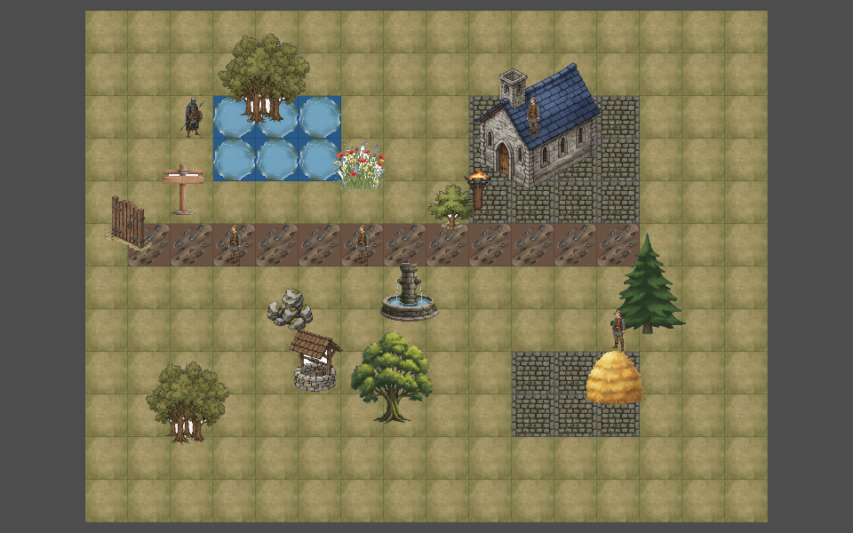
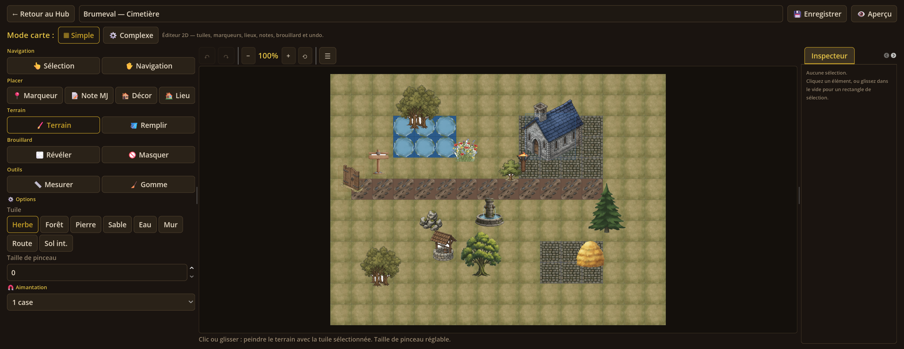

# Carte 2D simple — état des lieux et cible « RPG Maker / Pokémon DS »

> **Branche** : `feat/carte-2d-simple` (depuis `main` @ `bf6daa1`) · **Date** : 30 octobre 2026
>
> **Objectif produit (demande utilisateur)** : « bosser sur la map 2D simple du jeu,
> ça doit permettre de tout faire mais de façon extrêmement simplifiée. Si on
> atteint du niveau graphique type RPG Maker ou Pokémon sur DS, on est bon. »
>
> **Documents liés** :
> - [CARTE_2D_CONTRAT_ATLAS.md](./CARTE_2D_CONTRAT_ATLAS.md) — contrat technique assets ↔ moteur
> - [CARTE_2D_FONCTIONNEL.md](./CARTE_2D_FONCTIONNEL.md) — inventaire fonctionnel vérifié
> - [INTERACTIVE_MAPS.md](./INTERACTIVE_MAPS.md) — architecture dual-mode simple/complexe
> - [MAP_EDITOR.md](./MAP_EDITOR.md) — éditeur de cartes

---

## 1. Résumé exécutif

La carte simple **existe déjà et elle est fonctionnellement riche** : éditeur 2D
complet (peinture de terrain, décors, marqueurs, lieux, notes, brouillard,
mesure, undo/redo, biblio d'assets), session MJ/joueur, navigation monde ↔
local, brouillard par cases, sauvegarde. Le détail vérifié est dans
[CARTE_2D_FONCTIONNEL.md](./CARTE_2D_FONCTIONNEL.md).

**Le problème n'est donc pas la fonctionnalité, c'est le rendu.** Aujourd'hui :

| Constat | Cause |
|---|---|
| Sol en damier, coutures et motifs qui bavent | chaque case = un aplat de couleur + une texture peinte **répétée** ; aucune transition (autotile) entre terrains |
| Terrains visuellement identiques (forêt = herbe, sable = sentier…) | `MapData.get_tile_texture_path()` réutilise 5 PNG pour 21 terrains |
| PNJ immobiles, toujours de face, sans marche | les personnages sont des PNG peints statiques (7 fichiers), sans direction ni frames |
| Profondeur absente (arbres posés « à plat », pas d'ombres) | `InteractiveMap._draw()` dessine sol → props → zones → marqueurs/tokens sans tri Y ni ombre de contact |
| Mélange de styles (textures peintes « IA », emojis, aplats UI) | pas de palette unique ni de direction artistique centrale |

La cible « RPG Maker / Pokémon DS » se traduit par **un pipeline d'assets
tuilé + un renderer dédié**, pas par de nouvelles fonctionnalités :

> **Tuiles 16 px cohérentes + autotile + palette unique + personnages chibi
> 4 directions animés + tri Y/ombres + décors semés.**

C'est exactement ce que cette branche met en place (voir § 5).

---

## 2. La cible, rendue mesurable

Barème de réussite (une carte simple est « au niveau » si **tout** est coché) :

| # | Critère | Cible RPG Maker / Pokémon DS | État 30/10 (avant) | Priorité |
|---|---|---|---|---|
| 1 | **Sol tuilé** | tuiles 16 px, autotile blob 47 variantes, transitions herbe↔chemin↔eau↔pierre sans couture | aplats + textures répétées, pas d'autotile | **P0** |
| 2 | **Variation** | décors semés (touffes, fleurs, cailloux), aucun motif qui se répète à l'identique sur toute la carte | sol strictement identique d'une case à l'autre | **P0** |
| 3 | **Palette** | palette unique et centralisée (`tools/tileset/quest_palette.py`), 3–4 valeurs par tuile, pas d'outline sur les sols | couleurs `tiles.json` + textures peintes + UI, sans référentiel | **P0** |
| 4 | **Personnages** | sprites chibi 16×32, 4 directions, 3 frames de marche, ombre de contact, silhouettes distinctes par rôle | PNG peints fixes, une seule orientation | **P0** |
| 5 | **Profondeur** | tri Y (baseline), props debout vs sol, personnages qui passent derrière un arbre | dessin par couches fixes, aucun tri | **P0** |
| 6 | **Eau / animations** | eau animée 4 frames, écume sur les berges | eau statique | **P1** |
| 7 | **Décors** | arbres, buissons, rochers, bâtiments en pixel-art intégrés à l'échelle de la grille | découpes peintes à échelles variables, style hétérogène | **P1** |
| 8 | **Cadrage / lisibilité** | carte entière lisible, zoom crispe (nearest), pas de flou | cadrage OK, textures floues à 1,5× | **P1** |
| 9 | **Tout faire en simplifié** | peindre, décorer, PNJ, lieux, notes, brouillard, tokens, navigation, mesure, undo — même rendu en session et en édition | déjà couvert (voir audit fonctionnel) | ✅ |
| 10 | **Non-régression** | cartes existantes (`demo-crypte-brumeval`) et mode complexe 3D inchangés | — | **P0** |

Une capture de référence est produite à chaque étape par le harnais
`game/scripts/tests/simple_2d_shot_test.gd` (voir § 6) :
`docs/screenshots/carte_2d_avant_render.png` (avant) puis
`carte_2d_pixel_render.png` (pixel-art).

État « avant » (30/10/2026) :





---

## 3. Comment le rendu fonctionne aujourd'hui

**`game/scripts/interactive_map.gd`** (1 103 lignes, `InteractiveMap`) est le
moteur unique du mode simple — éditeur, session et aperçu hub. Son `_draw()` :

1. pour chaque case : `draw_rect(couleur du terrain)` puis
   `draw_texture_rect(texture du terrain)` (même texture étirée sur la case) ;
2. `_draw_props()` : découpes PNG, opacité, pas de tri ;
3. `_draw_areas()`, brouillard, marqueurs (sprites/emoji), tokens (images) ;
4. overlay éditeur (sélection, rectangle, mesure, notes).

Données : `game/data/tiles.json` ne contient que des **couleurs** (8 terrains
local, 9 monde, 4 enquête). `MapData.get_tile_texture_path()` mappe ces
identifiants vers 5 PNG peints (`herbe`, `sentier_boueux`, `dalles_pierre`,
`eau_mare`, `pave`) — d'où la répétition et l'absence de transitions.

Personnages : `MapData.get_character_sprite_path()` choisit parmi 7 PNG peints
(`villageois`, `garde`, …), affichés via `_draw_sprite_fitted()` — une seule
orientation, aucune animation.

Décors : `MapAssetLibrary` charge les PNG de `game/data/props/` (catégories
bâtiments, végétation, mobilier…), détoure le fond clair à la volée et les pose
en cases. Ce sont des images « peintes IA », pas du pixel-art : mélange de
styles avec les sols et échelles incohérentes.

**Ce qui est déjà bon et à préserver** : grille de cellules → écran
(`cell_rect`, `grid_to_screen`, `_pos_to_cell`) utilisée par les overlays, le HUD,
les bulles de dialogue et les tests ; outils éditeur ; fallback couleur si un
asset manque ; navigation monde ↔ local.

---

## 4. Écarts prioritaires (ce qui empêche la cible)

1. **P0 — Pas d'autotile** : aucun calcul de voisinage, transitions inexistantes.
2. **P0 — Pas de personnages animés** : PNJ/tokens figés, sans direction.
3. **P0 — Pas de tri Y ni d'ombres** : profondeur nulle, décors « posés ».
4. **P0 — Assets hétérogènes** : découpes peintes IA + emojis + aplats ; pas de
   direction artistique ni de palette.
5. **P1 — Pas de décors semés** : répétition visible de la texture de sol.
6. **P1 — Eau statique**, pas d'écume de berge.
7. **P1 — Échelle des décors** variable et sans ancrage au sol (flottements).
8. **P2 — Flou de texture** au zoom (pas de filtrage nearest).
9. **P2 — Décors pixel-art manquants** : arbres, buissons, rochers, bâtiments.

---

## 5. Plan de la branche

| # | Milestone | Contenu | Preuve |
|---|---|---|---|
| **M0** | Baseline + contrat | branche, captures avant/après reproductibles, contrat atlas, palette centralisée | ce document + `simple_2d_shot_test.gd` + `CARTE_2D_CONTRAT_ATLAS.md` |
| **M1** | Assets pixel-art | atlas de terrains 16 px (47 variantes/autotile, eau animée, décors semés) + feuille de personnages 16×32 (4 dir × 3 frames), manifestes JSON, générateurs Python reproductibles, aperçus hors-Godot | `docs/screenshots/carte_2d_tileset_preview.png`, `carte_2d_characters_preview.png`, manifests |
| **M2** | Renderer pixel-art | chargeur + autotile + passes de sol/décor + tri Y + ombres + personnages animés, fallback si atlas absent, `pixelArt:false` par carte | captures `carte_2d_pixel_*`, tests headless |
| **M3** | Décors pixel-art | arbres/buissons/rochers/bâtiments pixel + ancrage au sol, remplacement progressif des découpes peintes en mode simple | captures démo village |
| **M4** | Carte démo « village » | une carte simple 30×20 jouable qui montre tout : village, rivière, chemins, PNJ animés, lieux cliquables, brouillard | capture + test de navigation |
| **M5** | Finition + docs | README, docs à jour, nettoyage, revue des tests, comparaison avant/après | `run_tests` + revue Lead |

**État au 30/10/2026** : M0 terminé (baseline capturée, contrat écrit). M1 et
M2 en cours (assets et renderer produits en parallèle). M3–M5 à suivre.

---

## 6. Vérification (reproductible)

```powershell
cd D:\git\OpenQuest_jdr

# 1. Tests headless (dont le test du renderer pixel)
.\scripts\run_tests.ps1        # ou runs ciblés ci-dessous
godot --headless --path game --script res://scripts/tests/simple_pixel_render_test.gd --quit

# 2. Captures avant/après — SANS --headless
& $godot --path game --user-data-dir .test_userdata `
    --script res://scripts/tests/simple_2d_shot_test.gd -- --prefix=carte_2d_avant
& $godot --path game --user-data-dir .test_userdata `
    --script res://scripts/tests/simple_2d_shot_test.gd -- --prefix=carte_2d_pixel
```

Sorties : `docs/screenshots/<prefix>_render.png` (moteur seul, 960×600),
`_session.png` (session MJ complète), `_editeur.png` (éditeur 2D), `_apercu.png`.
Les quatre captures avant sont commitées comme référence.

---

## 7. Décisions et risques

| Décision | Justification |
|---|---|
| **Pixel-art 16 px** pour la carte simple | c'est la cible demandée (RPG Maker/DS) ; nécessaire pour l'autotile et la cohérence |
| Le mode **complexe 3D reste peint** | pas de régression du diorama ; les deux modes ont des styles assumés différents |
| **Assets générés par script** (Python/Pillow) et non pack externe | reproductible, licence maîtrisée (pas d'asset tiers à créditer), itérable, palette unique. Risque : qualité artistique à prouver par les aperçus — itération visuelle obligatoire |
| **Manifeste JSON** entre assets et moteur | le moteur ne code aucune couleur/layout en dur ; régénérer les assets ne touche pas le GDScript |
| **Fallback obligatoire** | si atlas/manifeste absent ou invalide → rendu historique ; aucune carte existante ne casse |
| `pixelArt: false` par carte | permet de comparer et de revenir en arrière sans branche |
| Tests headless + captures windowed | le rendu ne se valide pas en headless ; les tests logiques (masque, hash, fallback) restent headless |

Risques suivis : temps de génération/qualité des sprites procéduraux (mitigation :
aperçus + itérations), performance de dessin case-par-case (mitigation : cache
d'atlas, throttle animation, redraw uniquement si visible), régressions de
l'éditeur (mitigation : suite de tests existante + harnais de captures).

---

*OpenQuest JDR — état des lieux carte 2D simple, 30 octobre 2026.*
