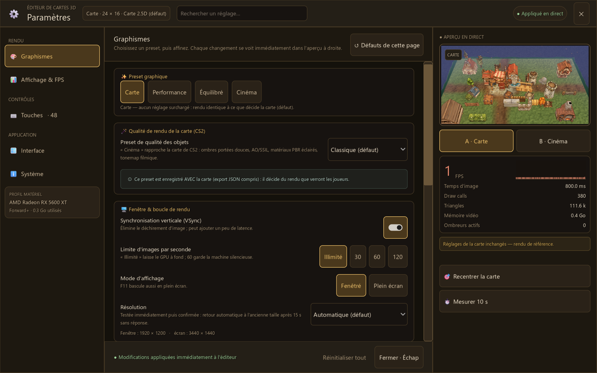
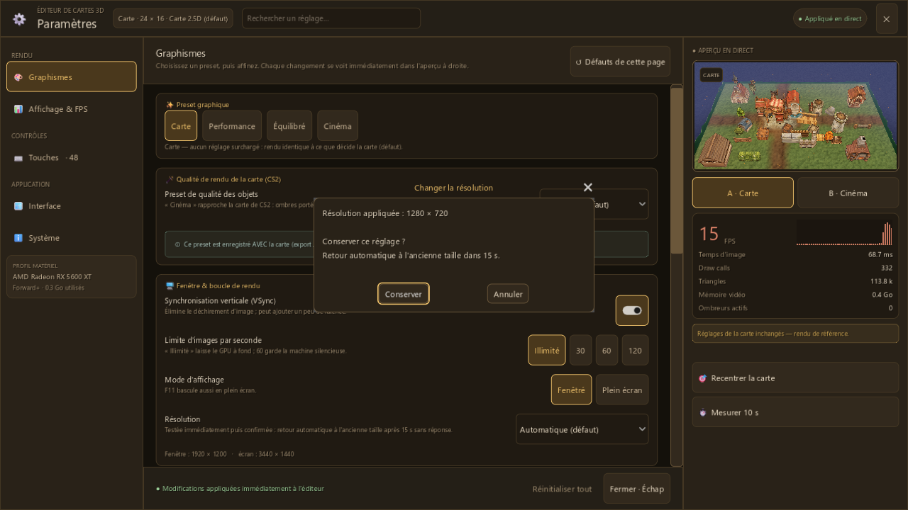
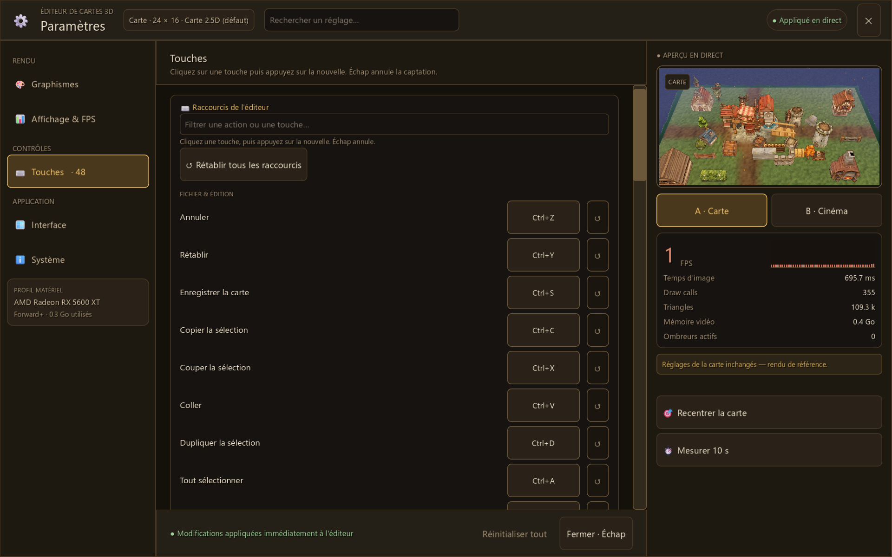
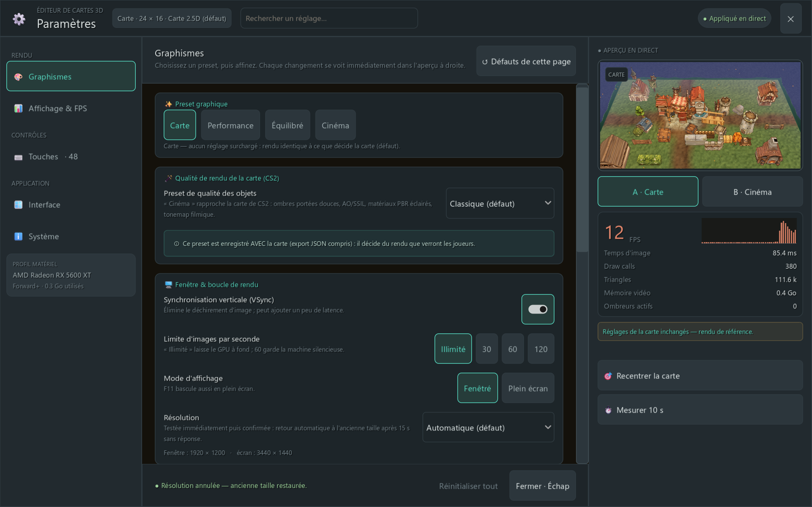
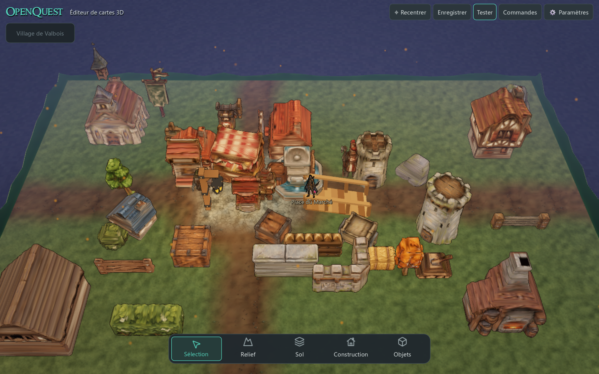
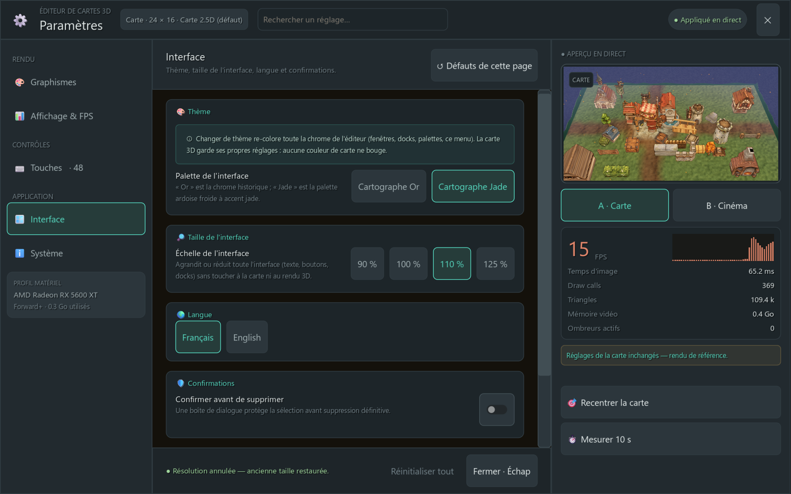
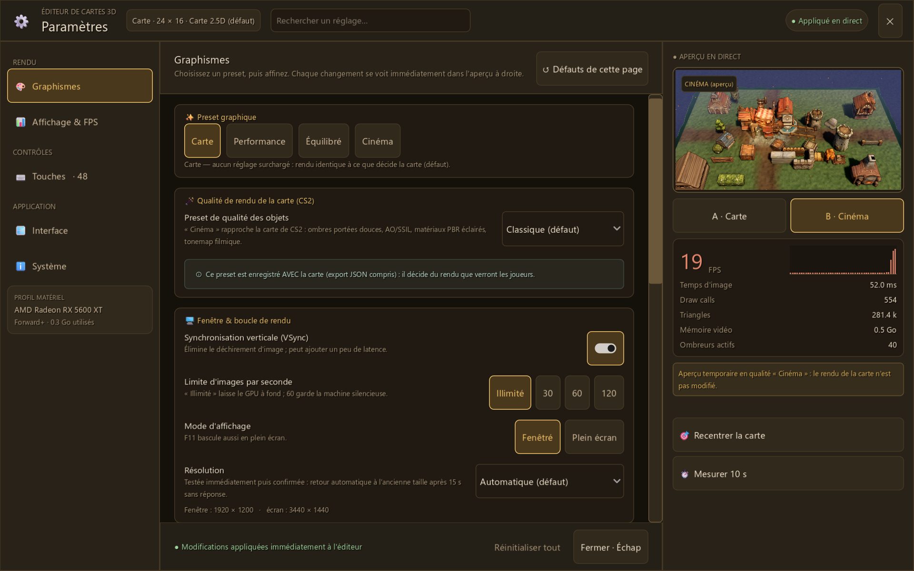

# Menu Paramètres de l'éditeur de cartes 3D

> Atelier plein écran (F10) : graphismes, compteur FPS, touches, interface et
> diagnostic. Règle les préférences d'**application** — les réglages qui
> appartiennent à une carte restent dans l'onglet **Carte**.
>
> 

---

## 1. Ouvrir le menu

Trois entrées, toutes équivalentes :

| Entrée | Chemin |
|---|---|
| Clavier | `F10` |
| En-tête de l'éditeur | bouton **⚙ Paramètres**, à droite de **Commandes** |
| Menu Échap | **⚙ Paramètres…** |

`Échap` ou `F10` referment le menu. Il s'ouvre par-dessus la carte, sans
changer le document : aucune modification n'est enregistrée dans la carte
tant que vous ne touchez pas au preset de qualité CS2 (voir §3).

## 2. Ce que le menu contient

### Graphismes

- **Preset graphique** — `Carte` (défaut), `Performance`, `Équilibré`,
  `Cinéma`. Un cran écrit les réglages fins ci-dessous en une fois ; ils
  restent modifiables ensuite.
- **Qualité de rendu de la carte (CS2)** — `Classique` / `✨ Cinéma`. C'est le
  **seul réglage du menu enregistré avec la carte** (`qualityPreset`), donc
  exporté en JSON et vu par les joueurs.
- **Fenêtre & boucle de rendu** — VSync, limite d'images (Illimité / 30 / 60 /
  120), mode fenêtré / plein écran (persistant, suit aussi `F11`), et
  **résolution** : `Automatique`, la résolution native de l'écran, les presets
  courants (3840×2160 → 1024×768) et toujours la taille actuelle. La nouvelle
  taille est appliquée pour **essai**, puis une boîte demande de la conserver ;
  sans réponse elle revient à l'ancienne taille après **15 s** (patron classique
  des jeux, utile sur un écran qu'on ne lit pas). La valeur n'est enregistrée
  qu'après « Conserver » ; `Échap` ou « Annuler » restaure l'état précédent
  (taille **et** mode fenêtré/plein écran). La taille mémorisée est bornée à
  l'espace utilisable de l'écran courant, donc un changement de moniteur ne
  peut pas rendre la fenêtre inatteignable.

  
- **Netteté** — anti-aliasing (`Auto`, `Aucun`, `FXAA`, `MSAA 2×/4×/8×`) et
  échelle de rendu 3D (50 → 100 %).
- **Ombres & occlusion** — qualité des ombres (`Comme la carte`, `Désactivées`,
  `Basses`, `Moyennes`, `Hautes`), portée, occlusion ambiante (SSAO), lumière
  indirecte (SSIL), glow.
- **Eau & atmosphère** — réflexions de l'eau, brume volumétrique.

### Affichage & FPS

Compteur FPS (afficher / masquer, détail `ms · draw calls`, position barre
d'état ou coin supérieur droit), graphe de frametime, seuil d'alerte, mini-carte,
barre d'aide contextuelle, délai des infobulles.

### Touches

Les 48 raccourcis de l'éditeur (édition, outils, affichage, fenêtre) sont
**remappables** : cliquer sur la touche, appuyer sur la nouvelle, `Échap`
annule. Un conflit est refusé avec le nom de l'action qui occupe déjà la touche ;
`Échap`, `Entrée` et `Espace` sont réservés à l'interface. Chaque ligne a un
bouton `↺` pour revenir au défaut, et « Rétablir tous les raccourcis » remet
tout à zéro. Les infobulles des outils de la palette affichent la touche réelle.



### Interface

- **Thème** — variante de palette de l'interface : **Cartographe Or** (chrome
  historique brun/or) ou **Cartographe Jade** (palette ardoise froide à accent
  jade). Le changement est **immédiat et complet** : thème Godot de l'éditeur,
  chrome immersive (en-tête, dock, panneaux), palettes d'outils, volant
  d'outils, inspecteur, calques, ce menu et ses boîtes de dialogue. Seules les
  couleurs **fonctionnelles** ne bougent pas (matières du terrain, poignées de
  sélection, aperçus d'objets) — et évidemment la carte 3D elle-même.
- **Taille de l'interface** — 90 / 100 / 110 / 125 % : agrandit ou réduit toute
  l'interface (texte, boutons, docks) via le facteur d'échelle du canvas racine,
  sans toucher aux réglages de la carte. À 110/125 %, la vue 3D est rendue dans
  l'espace d'interface agrandi (léger adoucissement, léger gain GPU) : c'est
  l'arbitrage habituel d'une mise à l'échelle d'UI.
- **Langue** (voir `LocaleSettings`, `user://app_settings.cfg` section `[ui]`),
  confirmation avant suppression. Les politiques de sauvegarde et les réglages
  d'auteur restent dans l'onglet Carte (le menu le rappelle).







### Système

Version, moteur de rendu, GPU, mémoire vidéo utilisée, dossier utilisateur,
ouverture du dossier, export d'un diagnostic (`user://openquest_diagnostic.txt`)
et réinitialisation complète.

## 3. Portée des réglages : global vs carte

| Nature | Où | Exemples |
|---|---|---|
| **Identité visuelle de la carte** (voyage avec l'export JSON) | `map_data`, onglet Carte | `qualityPreset`, `renderStyle`, `groundMode`, `grid`, `fogEnabled`, `lighting`, `atmosphere`, `waterDecor*`, `vegetation*` |
| **Confort / performance de la machine** | `user://app_settings.cfg` | `max_fps`, `vsync`, `window_mode`, `window_width`, `window_height`, `aa`, `render_scale`, `shadow_quality`, `ssao`, `ssil`, `glow`, `volumetric_fog`, `water_reflections`, `fps_*`, `theme`, `ui_scale`, `confirm_delete`, `show_minimap`, raccourcis |
| **État de session** (jamais persisté) | éditeur | rayons de brosse, outil actif, zoom, sélection |

**Garantie de neutralité** : par défaut (`preset = carte`, `aa = auto`,
`shadow_quality = map`), le menu **ne surcharge rien** — le rendu de la carte
reste strictement celui qu'elle définissait, ce qui préserve les tests de
capture et l'identité visuelle exportée. Les surcharges sont volontairement
**réductrices** : elles peuvent couper des ombres, l'AO, le glow ou les
réflexions, jamais en ajouter que la carte n'a pas décidées.

## 4. Aperçu en direct

La colonne de droite affiche la **texture réelle du SubViewport 3D** du moteur
(pas une capture) avec :

- lift **A · Carte** / **B · Cinéma** : bascule temporaire du preset de qualité
  dans le moteur, pour comparer à l'œil ; le document n'est pas modifié et
  l'état de la carte est restauré à la fermeture ;
- FPS (moyenne glissante), temps d'image, draw calls, triangles, mémoire vidéo,
  nombre d'ombreurs actifs ;
- graphe de frametime (48 dernières mesures) ;
- avertissements contextuels (échelle < 100 %, ombres coupées, réflexions
  coupées, preset Cinéma de la carte…) ;
- **Mesurer 10 s** : moyenne et minimum d'images pour trancher un preset.



## 5. Thème : variantes et recoloration à chaud

`CartographerTheme` (script `game/scripts/theme/cartographer_theme.gd`) porte
**deux palettes complètes** de la même mise en page :

| Variante | Rôle |
|---|---|
| `or` (défaut) | chrome immersive historique : brun profond, accent or |
| `jade` | palette « Dark Cartographer » documentée : ardoise froide, accent jade |

`palette(variant)` retourne le dictionnaire de tokens, `color(key)` la couleur
de la variante active, `build(immersive, variant)` construit le `Theme` Godot
(avec les variations `SectionLabel` / `CaptionLabel` / `HeadingLabel` /
`DangerButton` utilisées par les docks).

Le changement de variante est **complet** parce que toute l'interface tire ses
couleurs de `CartographerTheme.color(...)` :

1. le `Theme` Godot de l'éditeur est reconstruit (`theme = build(true, variant)`) ;
2. `_retheme_subtree()` re-colore à chaud les surcharges locales déjà posées
   (`add_theme_color/stylebox_override`) : chrome immersive, dock, palettes,
   volant d'outils, inspecteur, calques, menu Paramètres et ses dialogues ;
   la correspondance est sémantique (`retheme_colors(ancienne, nouvelle)`), donc
   les couleurs **fonctionnelles** (matières du terrain, poignées de sélection,
   aperçus d'objets) ne sont pas touchées ;
3. les palettes reconstruites relisent la palette active à la construction.

Rien de tout cela ne touche la carte 3D : elle garde son preset, sa lumière et
son ambiance.

## 6. Taille de l'interface

`ui_scale` (90 / 100 / 110 / 125 %) est appliqué au **canvas racine** via
`Window.content_scale_factor` : tout le 2D (texte, boutons, docks, menus)
s'adapte d'un coup, et l'éditeur recalcule ses largeurs de docks
(`_apply_responsive_layout`). La carte reste inchangée dans ses données ; seule
sa résolution d'affichage suit l'espace d'interface.

## 7. Fichiers

| Rôle | Fichier |
|---|---|
| Persistance + application (autoload) | `game/scripts/autoload/app_settings.gd` |
| Palettes or / jade + `Theme` Godot | `game/scripts/theme/cartographer_theme.gd` |
| UI de l'atelier | `game/scripts/maps/editor/map_editor_parametres.gd` |
| Surcharges de rendu dans le moteur | `game/scripts/maps/complex_map_engine_3d.gd` (`set_global_overrides`, `_apply_global_overrides`) |
| Entrées (F10, en-tête, Échap), traduction des touches, recoloration | `game/scripts/maps/map_complex_editor.gd` |
| Entrée du menu Échap | `game/scripts/maps/editor/map_editor_esc_menu.gd` + `game/scenes/map_editor/panels/esc_menu.tscn` |
| Palette d'outils / volant / options / inspecteur / calques | `game/scripts/maps/editor/v2/palette.gd`, `v2/tool_flyout.gd`, `map_editor_tool_options.gd`, `map_editor_inspector.gd`, `map_editor_outliner.gd` |
| Session (mêmes préférences) | `game/scripts/session/panels/map_stage.gd` |
| Tests | `game/scripts/tests/map_editor_parametres_test.gd`, `..._shot_test.gd`, `map_cartographer_theme_test.gd` |

## 8. Point d'application (important)

`ComplexMapEngine3D.configure()` réapplique les valeurs de la carte à chaque
édition. Les préférences globales sont donc réécrites **après** :

- `map_complex_editor.gd` → `_sync_engine()` : `AppSettings.apply_to_engine(_engine)` ;
- `complex_map_engine_3d.gd` → fin de `_apply_lighting()` et de
  `_apply_render_quality()` : `_apply_global_overrides()` ;
- `map_stage.gd` (session) : `AppSettings.apply_to_engine(_complex)`.

L'éditeur enregistre son moteur (`AppSettings.register_engine`), donc un
changement dans le menu s'applique immédiatement sans repasser par `configure()`.

## 9. Remap des touches (fonctionnement)

Le gestionnaire clavier de l'éditeur teste des keycodes en dur. Plutôt que de le
réécrire, `AppSettings.translate_key_event()` :

1. traduit une touche remappée vers la touche d'origine attendue par l'éditeur ;
2. renvoie `null` pour l'ancienne touche d'une action remappée (neutralisée) ;
3. laisse passer tout le reste.

Les conflits et les touches réservées sont refusés à la saisie. Les raccourcis
sont persistés dans `user://app_settings.cfg`, section `[keys]` (uniquement les
actions personnalisées).

## 10. Tests

```powershell
# persistance, surcharges moteur, remap, thème, taille UI, entrées F10/Échap
godot --headless --path game --script res://scripts/tests/map_editor_parametres_test.gd

# thème « or »/« jade » et captures (sans --headless) : user://parametres_shots/
godot --headless --path game --script res://scripts/tests/map_cartographer_theme_test.gd
godot --path game --script res://scripts/tests/map_editor_parametres_shot_test.gd
```

Le test vérifie notamment qu'un `configure()` ne réinitialise pas les
préférences, que l'ancienne touche d'une action remappée ne déclenche plus rien,
que le flux **résolution** est sain (essai non enregistré, « Conserver » persiste,
« Annuler »/`Échap` restaure), et que le **thème** bascule dans les deux sens
(`Theme` reconstruit, surcharges recolorées) avec la **taille d'interface**
appliquée au canvas racine.
