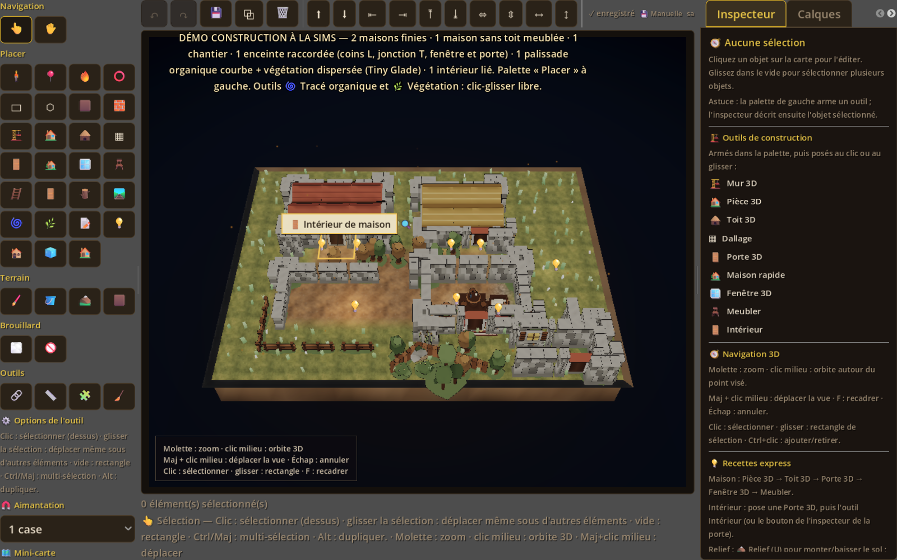
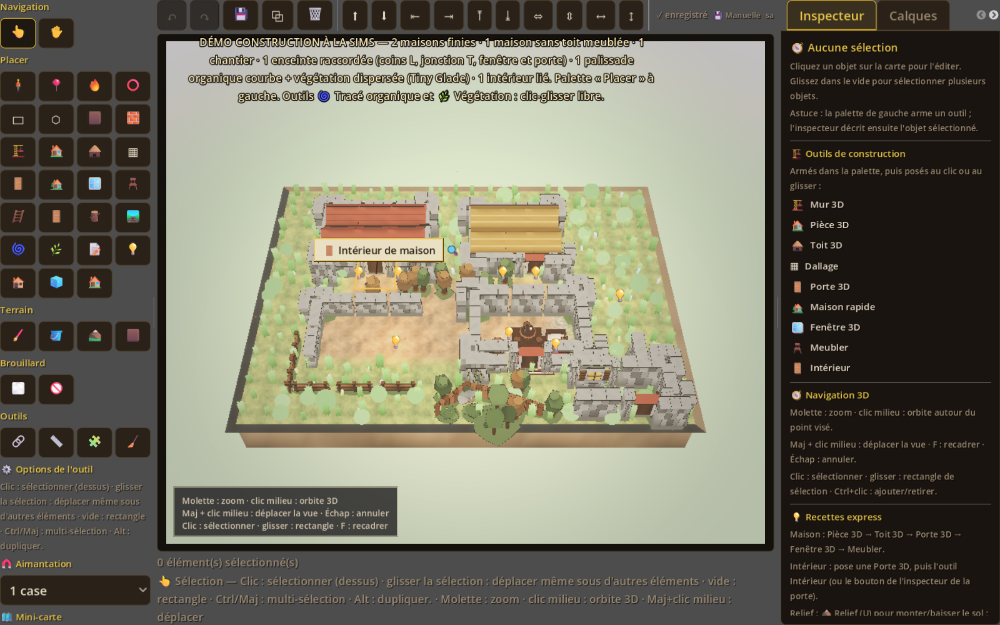

# Passe visuelle « Tiny Glade » — carte 2.5D (task-31)

Branche `feat/carte-2.5d-editeur`. Objectif : rapprocher le rendu de la direction
artistique Tiny Glade (ciel pastel, lumière chaude, végétation dense, profondeur)
sans refonte d'assets ni modification de la logique d'édition.

## Captures avant / après

| Avant | Après |
|---|---|
|  |  |
| Fond noir/bleu nuit, herbe olive terne, lumière matin froide, végétation discrète, backdrop brun sombre masquant le ciel. | Ciel/horizon pastel ivoire, soleil chaud, ombres douces, herbe plus verte et fleurie, buissons, brume de profondeur, vignettage radial, backdrop « prairie pastel ». |

Les deux captures proviennent du **même script fenêtré existant**
`game/scripts/tests/construction_demo_shot_test.gd` (sans `--quit`), sur la démo
construction. `construction_demo.png` est la capture courante ; les copies
`tiny_glade_avant.png` / `tiny_glade_apres.png` servent de comparaison.

## Ce qui a été implémenté

### 1. Ciel procédural (terrain3d uniquement)
- `Environment.background_mode = BG_SKY` avec une **Sky** dont le matériau est un
  shader inline `shader_type sky` : haut bleu pâle, horizon crème, sol pastel,
  dégradé doux + **halo solaire discret** (`LIGHT0_DIRECTION`).
- Création paresseuse/réutilisée (`_sky`, `_sky_material`), appliquée par
  `_apply_sky()` dans `_apply_lighting()`.
- **Fallback** : si la sky n'est pas disponible → fond uni pastel.
- **Illustré et vue table inchangés** (BG_COLOR historique, pas de sky).
- API : `is_sky_active()`, `get_sky_material()`.

### 2. Preset lumière « Tiny Glade »
- Ajouté dans `MapData.LIGHTING_PRESETS` (et `LIGHTING_PRESET_ORDER`) :
  soleil chaud `#ffe3b8` énergie 1.55, ambiance pastel `#cfe6ff` 0.62,
  exposition 1.0, fog 0.002, glow 0.45, ombres douces (`shadowBlur` 1.7),
  saturation 1.20 / contraste 1.08, et paramètres de ciel (`sky`, `skyTop`,
  `skyHorizon`, `skyGroundBottom`, `sunGlow`, `fogSkyAffect`, `fogColor`) +
  palette de backdrop (`backdropCenter/Mid/Edge`).
- Sélectionné dans `game/scripts/debug/construction_demo_boot.gd`
  (`preset: "tiny_glade"`, `intensity: 0.55`).
- Les autres presets (jour/matin/coucher/nuit/donjon) gardent leurs valeurs et
  leur fond uni.

### 3. Végétation dense
- `map_vegetation_3d.gd` : densités portées à **0.85 touffes/case**,
  **0.18 fleurs/case**, **0.16 buissons/case** ; touffes plus hautes/larges
  (3 quads croisés, 0.85 case de haut), fleurs plus visibles.
- Palette de fleurs élargie : blanc/crème, jaune, rose, bleu, orange, lilas.
- **Buissons** : troisième `MultiMeshInstance3D` (sphères basses) pour donner du
  volume au feuillage.
- Vent conservé (shader inline), couleurs d'instance plus saturées, teinte de
  nuit ajustée ; caps de performance 5000 touffes / 1800 fleurs / 900 buissons.
- Toujours aucune ombre portée, aucune collision, désactivée en vue table /
  illustré ; API : `get_vegetation_counts()` renvoie `{tufts, flowers, bushes}`.

### 4. Profondeur / ambiance
- **Vignettage radial** (shader canvas inline) au lieu de l'aplat noir uniforme ;
  API `get_vignette_strength()`.
- **DOF très léger** via `CameraAttributesPractical` **sur la `Camera3D`**
  (attention : en Godot 4 les attributs DOF vivent sur la caméra, pas sur
  `Environment`) : uniquement terrain3d + perspective + hors vue table.
  API `get_camera_attributes()`.
- `_apply_render_quality()` lit désormais **glow/saturation/contraste/luminosité**
  du preset courant, ce qui rend le preset Tiny Glade réellement distinct.

### 5. Backdrop accordé au ciel
- `map_backdrop_3d.gd` accepte une **palette** (`configure(..., palette)` /
  `set_palette()`), pour ne plus afficher le grand plan brun sombre derrière
  l'îlot quand un preset lumineux est actif : le plan devient une **prairie
  pastel** (centre vert clair, bord crème) qui se fond dans l'horizon.

## Tests

`game/scripts/tests/map_render_quality_test.gd` étendu (headless, sans `--quit`) :
- existants conservés : SSAO, glow, ACES, ombres, soleil chaud, nuit, végétation,
  marche des tokens, pulsation d'arrivée ;
- **Tiny Glade** : `is_sky_active()`, `BG_SKY`, matériau de ciel avec
  `shader_type sky`, soleil chaud > 1.2, ambiance pastel, fog de profondeur,
  glow doux, saturation > 1.12, **végétation dense** (touffes > 100, fleurs > 10,
  buissons > 0), vignettage > 0, DOF actif, puis retour nuit sans ciel résiduel
  (`not is_sky_active()` et `BG_COLOR`).

Validation :

```powershell
$env:GODOT_BIN = "C:\Users\Leo\AppData\Local\Microsoft\WinGet\Packages\GodotEngine.GodotEngine_Microsoft.Winget.Source_8wekyb3d8bbwe\Godot_v4.7.2-stable_win64.exe"
.\scripts\run_tests.ps1 -Filter '^map_render_quality_test$|^map_camera_test$|^session_' -TimeoutSeconds 180
```

## Limites honnêtes

- **Assets low-poly** : on ne retrouve pas la richesse géométrique de Tiny Glade
  (toits organiques, murs en pierre irrégulière, herbe volumétrique). La passe
  joue sur lumière/couleur/ciel/végétation procédurale, pas sur les modèles.
- Le ciel n'apparaît que dans le **ciel au-dessus de l'horizon** ; selon l'angle
  et le cadrage, on voit surtout l'horizon crème et le backdrop prairie. C'est
  volontaire pour éviter un ciel bleu incongru sous une caméra plongeante.
- Le DOF est **très léger** et seulement en perspective ; en ortho (VTT) il est
  désactivé pour ne pas flouter la lecture tactique.
- Les cartes illustrées, la vue table et l'éditeur hors carte restent inchangés.
- Le preset Tiny Glade est sélectionné dans la **démo construction** uniquement ;
  les cartes existantes gardent leur preset.

## Fichiers

- `game/scripts/maps/complex_map_engine_3d.gd` (sky, DOF, vignette, preset-driven render, backdrop palette)
- `game/scripts/maps/map_layers/map_vegetation_3d.gd` (densité, fleurs, buissons)
- `game/scripts/maps/map_layers/map_backdrop_3d.gd` (palette prairie pastel)
- `game/scripts/autoload/map_data.gd` (preset `tiny_glade` uniquement)
- `game/scripts/debug/construction_demo_boot.gd` (sélection du preset)
- `game/scripts/tests/map_render_quality_test.gd` (assertions Tiny Glade)
- `docs/TINY_GLADE_VISUEL.md` (ce document)
- Captures : `docs/screenshots/tiny_glade_avant.png`, `tiny_glade_apres.png`,
  `construction_demo.png` (régénérée par le script existant)

## Ce que le Lead peut vérifier / capturer

1. Lancer la démo construction (fenêtre dédiée, ne pas tuer celle de l'utilisateur) :
   `.\scripts\play-godot.ps1 res://scenes/debug/construction_demo.tscn`.
2. Vérifier le ciel/horizon pastel, la lumière chaude, les ombres douces, la
   densité de végétation (touffes/fleurs/buissons) et la profondeur (fog/DOF).
3. Comparer avec `docs/screenshots/tiny_glade_avant.png`.
4. Basculer le preset de lumière (Jour/Matin/Coucher/Nuit) pour vérifier que les
   autres ambiances et les cartes illustrées ne régressent pas.
