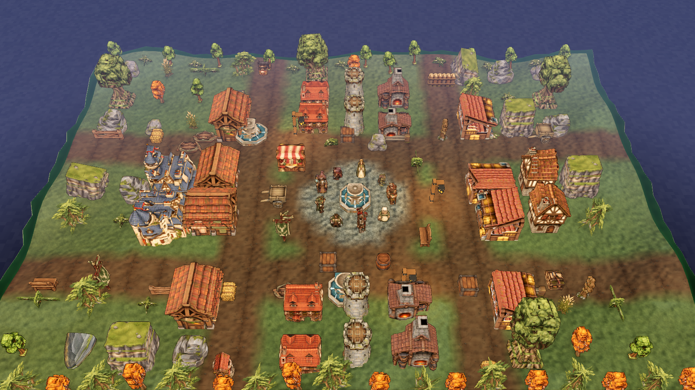
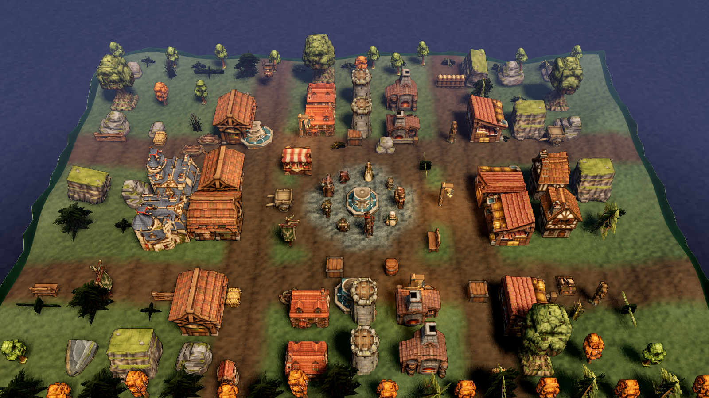
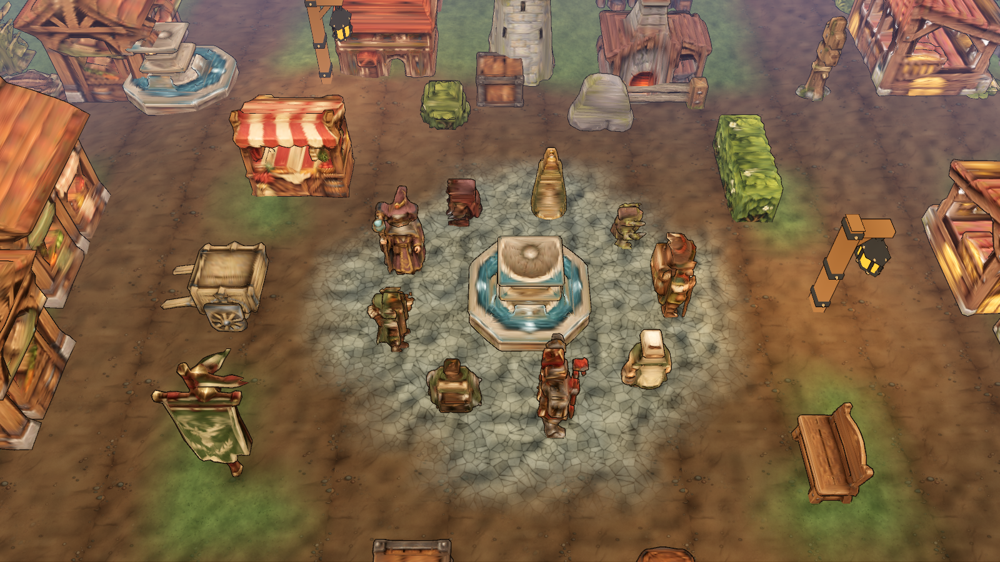
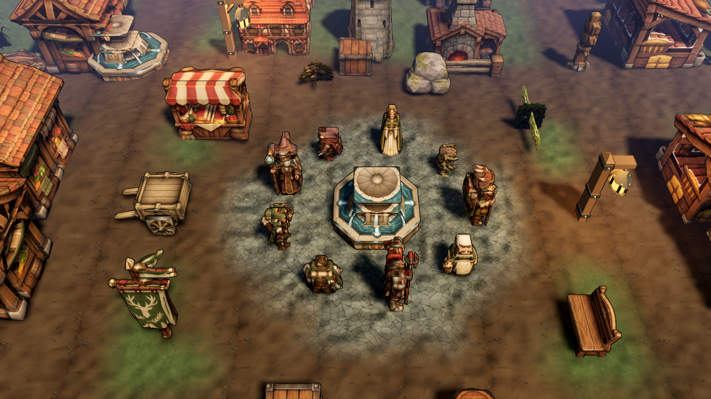
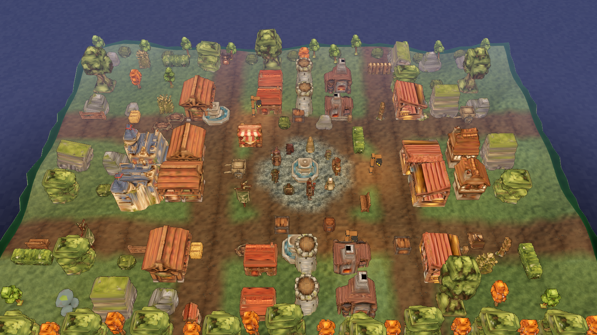
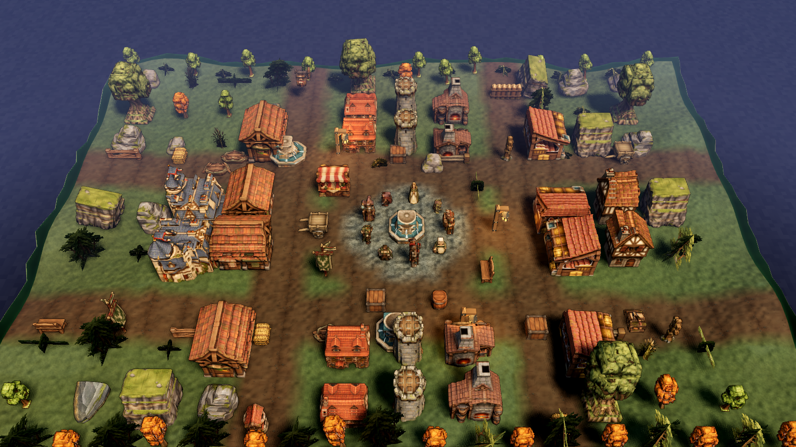
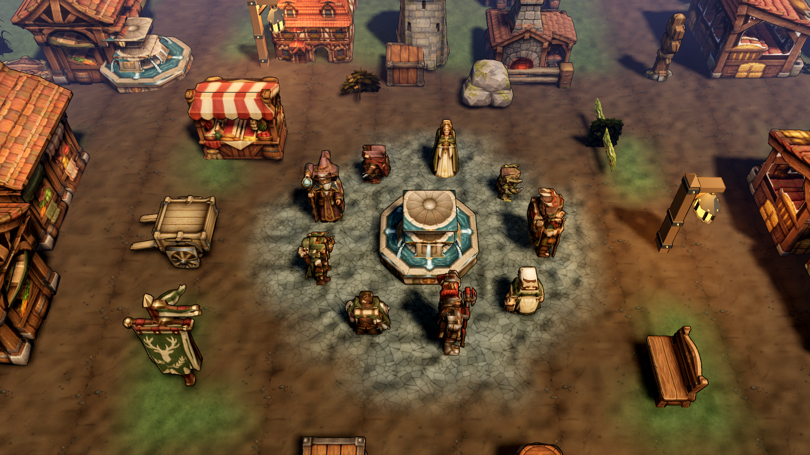
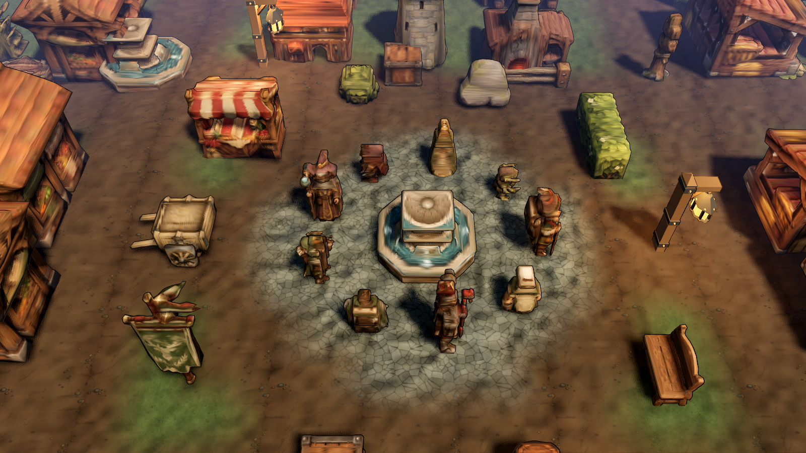

# Preset qualité « CS2 » — carte 2.5D peuplée d'objets 3D

Chantiers **rendu CS2** (`task-1` + suite `task-6`). Objectif : rapprocher une
carte 2.5D peuplée d'objets 3D (les 89 GLB de `game/assets/objects3d/`) du rendu
de **Cities: Skylines II**, sans changer l'identité visuelle Valbois (palette
chaude désaturée, matériaux mats, contour encre) et **sans aucune régression**
sur les styles existants.

La suite (`task-6`) ajoute trois choses : un **budget d'ombres par distance**
(perf sur cartes denses), la **vérification du rendu en session de jeu** (captures
A/B, identique à l'éditeur) et un **affinage de l'étalonnage** (toits rouges moins
saturés/brûlés, chaleur Valbois conservée).

Le chantier `task-8` corrige la **brume atmosphérique en vue de dessus** : sa
composante *hauteur* (`fog_height_density`, défaut 0,22) voilait d'un aplat les
cartes vues de haut (captures « Cité des Saules » / « rochers » lavées). Elle est
désormais **pondérée par l'angle de caméra** (nulle en vue plongeante, pleine en
vue rasante), A/B réversible, sans toucher à la composante profondeur.

Le rendu est piloté par un **preset opt-in, A/B réversible**, stocké dans les
données de carte :

```json
{ "qualityPreset": "classique" }   // défaut : rendu historique, strictement inchangé
{ "qualityPreset": "cinema"    }   // opt-in : cran de qualité CS2
```

La clé est **persistée dans la carte**, exportée/importée telle quelle en JSON, et
voyage donc vers les cartes démo (ex. « Cité des Saules ») qui l'activent.

---

## 1. Principe : une dimension orthogonale au style de rendu

Le **style** (`renderStyle` : `2.5d`, `diorama`, `vtt`, `dd2_hybrid`) décide de la
mise en scène (caméra, parallaxe, props plats/dressés, murs volumétriques).
Le **preset de qualité** décide du cran de rendu 3D, sans toucher à la mise en
scène : en `cinema`, la caméra, le tilt, le FOV, la parallaxe et la teinte de
profondeur du style sont **identiques** (vérifié par test).

| | `classique` (défaut) | `cinema` |
|---|---|---|
| Soleil | ombres de terrain déjà actives, aucun objet 3D ne projette | **objets GLB projettent leur ombre**, PCF 4 splits + blur, biais réglés |
| Budget d'ombres | — | **seuls les objets ≤ `shadowDistance` cases du point visé** projettent (défaut 70 cases, réévalué au mouvement caméra, hystérésis) |
| Objets 3D importés | non éclairés (couleurs/AO cuites) | **PBR éclairé** (albedo + vertex colors + textures conservés), mats |
| Profondeur | — | **perspective aérienne** légère sur les objets du fond |
| Ombre de contact peinte | pleine (0,25) | **atténuée** (×0,45) : le soleil fait le vrai travail |
| AO / SSIL | SSAO actuelle (1,35), SSIL seulement si le preset lumière l'active | **SSAO renforcée (1,75) + SSIL (0,85)** |
| Glow | preset lumière | **maîtrisé** (intensité ×0,82, bloom 0,012, seuil 1,12) |
| Tonemap | ACES, exposition du preset | ACES + **marge hautes lumières** (`tonemap_white = 2,4`), exposition ×0,99 |
| Étalonnage | preset lumière | **plancher + plafond** : saturation bornée 1,04–1,08, contraste borné 1,08–1,12 (palette Valbois, toits rouges non brûlés) |
| Brume de distance | brume atmosphérique existante | **conservée** (aucune modification) |
| Brume de hauteur | pleine en toute vue (voile en vue de dessus) | **pondérée par le tilt** : ~0 en vue plongeante, 0,41 à l'angle éditeur 2.5D, pleine en vue rasante |
| Session de jeu | identique éditeur | **rendu pixel-identique à l'éditeur** (même clé lue par `configure`, vérifié par captures) |

Sur un **fond illustré** (carte dessinée), le preset ne modifie que le
post-traitement : les objets restent « dessinés », non éclairés, sans ombres
portées, pour ne pas casser l'illustration. Le preset est donc sûr sur toutes
les cartes existantes.

`renderStyleOverrides` reste **prioritaire** : une carte peut forcer
`{"shadows": false}` même en `cinema` (A/B manuel).

---

## 2. Implémentation

### 2.1 Modèle et résolution — `game/scripts/maps/map_render_style.gd`

- `QUALITY_CLASSIQUE` / `QUALITY_CINEMA`, `QUALITY_PRESETS` (libellés + hints UI),
  `DEFAULT_QUALITY`.
- `quality_preset(map_data)` : résolution tolérante (`cinema`, `Cinéma`,
  `cinema_cs2`, `cs2`… → cinéma ; clé absente/inconnue → classique),
  `is_cinema()`, `quality_label()`, `quality_hint()`.
- `QUALITY_POST_OVERRIDES` (tonemap/AO/SSIL/glow/étalonnage) et
  `QUALITY_SURFACE_OVERRIDES` (ombres/litProps/matériaux/perspective aérienne),
  fusionnés dans `config()` **avant** les surcharges explicites de la carte.
- `quality_aerial_tint()`, `quality_aerial_amount()`, `quality_aerial_color()` :
  brume chaude (`#d9cdbc`) vers laquelle tend l'albédo des objets lointains.

En `classique`, `config()` renvoie **exactement** `CONFIGS[style]` (comparaison
JSON stricte dans le test) : aucun comportement modifié.

### 2.2 Ombres et ambiance — `game/scripts/maps/complex_map_engine_3d.gd`

- `configure()` lit `map_data["qualityPreset"]` dès le chargement (cartes
  existantes, JSON, cartes démo) → `_quality_preset`.
- API publique : `get_quality_preset()`, `is_cinema_quality()`,
  **`set_quality_preset(preset)`** — bascule A/B **sans reconstruire la carte ni
  déplacer la caméra** (reconstruit uniquement le calque des objets, réapplique
  éclairage + qualité + atmosphère).
- `_apply_lighting()` : `tonemap_white` (marge hautes lumières) et
  `exposureScale` du preset.
- `_apply_render_quality()` : branches `cinema` pour SSAO (rayon/intensité/
  détail), SSIL, glow, planchers/plafonds d'étalonnage, et **soleil** :
  `SHADOW_PARALLEL_4_SPLITS`, `shadow_blur ≥ 2,2`, biais 0,06 / normal 2,0,
  portée 190, splits 0,10 / 0,28 / 0,52.
  Retour en `classique` : **toutes** les valeurs historiques sont réécrites
  (mode orthographique, blur du preset, biais 0,04, portée 160, splits
  0,12/0,30/0,55, `tonemap_white = 1`) → A/B exactement réversible (testé par
  instantané JSON avant/après).

> **Détail technique notable** : la pénombre est obtenue par le *blur* du filtre
> d'ombre, pas par `light_angular_distance`. La pénombres angulaire large du
> moteur dithère les ombres (mouchetures très visibles sur les petits objets de
> près) : en `cinema` la taille angulaire est donc épinglée à 0 (constaté et
> corrigé pendant les captures, cf. § 5).

### 2.2 bis Budget d'ombres par distance — perf des cartes denses

Sur une carte dense, `cast_shadow = ON` sur *tous* les GLB double la passe de
géométrie (ombre + couleur) : c'est le surcoût principal du preset. Un budget
piloté par la distance limite la passe d'ombre à la zone regardée :

- réglage `shadowDistance` en **cases** dans `QUALITY_SURFACE_OVERRIDES`
  (défaut **70**, `-1` = illimité) ; surchargeable par carte via
  `renderStyleOverrides.shadowDistance` ;
- `MapMeshes3D` mémorise les nœuds capables de projeter (`_shadow_casters`) puis
  **allume/éteint `cast_shadow` sur les nœuds vivants** selon la distance au
  point visé — **aucune reconstruction des objets** ;
- réévaluation à chaque mouvement de caméra (`_process` → `_update_shadow_budget`
  seulement si la position/le zoom a changé), et après reconstruction du calque
  (chargement, gomme, bascule de preset) ;
- **hystérésis ×1,15** : un objet déjà éclairé reste allumé jusqu'à
  `shadowDistance × 1,15`, puis s'éteint ; il se rallume dès qu'il repasse sous
  le budget → pas de clignotement au pan/zoom ;
- en `classique`, le budget est inactif et aucun objet ne projette.
- API publique (tests, captures, tuning) : `set_shadow_budget_cells(cases)`,
  `get_shadow_budget_cells()`, `get_active_shadow_casters()`,
  `get_shadow_caster_count()` sur le moteur **et** le calque.

### 2.3 Objets 3D et ombres de contact — `game/scripts/maps/map_layers/map_meshes_3d.gd`

- `configure()` résout `litProps`, `cinemaQuality`, `contactShadowScale`,
  `materialRoughnessMin`, `depthTint` depuis `config()`.
- `_sanitize_visual(node, cast_sun_shadow, depth01)` :
  - en `cinema`, **`cast_shadow = ON` uniquement pour les meshes importés**
    (GLB), **jamais** pour la coque d'encre `*_outline` (détection sur le nom du
    nœud) ni pour les visuels procéduraux du moteur ni pour la cheminée/les
    lames plates ;
  - le sol/terrain reste récepteur (son matériau est éclairé) ;
  - en `classique`, tout reste `cast_shadow = OFF` comme avant.
- `_apply_lit_materials()` / `_lit_material()` : copie **par surface** de chaque
  `StandardMaterial3D` (les ressources partagées des `.scn` importés ne sont
  jamais modifiées en place), passage en `PER_PIXEL`, `vertex_color_use_as_albedo`,
  métal 0, roughness ≥ 0,86, et **perspective aérienne** (albédo → brume chaude
  selon `depth01 = y / hauteur_carte`, atténuée sur les matériaux très sombres
  pour préserver le trait d'encre).
- `_contact_shadow_material()` : opacité centrale × `contactShadowScale`
  (0,112 en cinéma contre 0,25 en classique) ; texture radiale re-générée
  proprement quand le preset change.
- Le TODO « phase 2 » documenté depuis le début du calque (teinte de profondeur
  des matériaux importés) est **traité ici**, uniquement en `cinema`.

### 2.4 UI — panneau Réglages (`Carte`)

- `game/scenes/map_editor/panels/settings.tscn` : nouveau conteneur
  `QualityGroup` (sous « Style de rendu »).
- `game/scripts/maps/editor/map_editor_settings_panel.gd` : groupe
  **« ✨ Qualité de rendu (CS2) »** avec `OptionButton` à deux entrées, hint
  dynamique par preset, `widgets["quality_preset"]`, signal
  `quality_preset_changed`.
  Le panneau découvre l'hôte éditeur en remontant la scène (il est instancié
  dans `map_editor.tscn`), écrit
  `doc.set_meta_values({"qualityPreset": …}, "Qualité de rendu")` (donc
  **une étape d'undo**, sauvegarde, export JSON) et se resynchronise sur
  `doc.changed` (chargement, undo/redo, import JSON). L'éditeur resynchronise
  déjà le moteur sur un changement `meta` : la bascule est immédiate.

### 2.5 Session de jeu — même rendu que l'éditeur

Le rendu de session passe par le **même** `ComplexMapEngine3D` (via
`MapStagePanel` → `stage._complex.configure(display_map, …)`), donc il lit la
même clé `qualityPreset` :

- aucune surcouche de session ne réécrit l'environnement ni la qualité : le seul
  chemin qui touche la carte est `GameData.apply_session_lighting_to_map()`, qui
  ne modifie que `lighting` en **mode nuit** — la clé `qualityPreset` et les
  autres réglages sont conservés (dupliqués avec la carte) ;
- les rafraîchissements de session (déplacement, changement de zone, refresh UI)
  replayent `configure()` : le preset reste actif (vérifié sur 3 refresh) ;
- cartes nuit et anciennes cartes sans clé : comportement sûr (nuit = cinéma
  conservé, carte sans clé = classique).

**Preuve** : deux captures via le vrai hôte de rendu de session
(`scenes/session/panels/map_stage.tscn`), à caméra identique à la capture
éditeur. Le rendu session cinéma est **pixel-identique au rendu éditeur
cinéma** (différence moyenne **0,0000**), et l'A/B session
classique/cinéma vaut **0,0710**, exactement la même valeur qu'en éditeur.

### 2.6 Brume atmosphérique adaptée au tilt — cartes nettes en vue de dessus

**Problème** : la brume atmosphérique a deux composantes — profondeur
(`FOG_MODE_DEPTH` + bande relative, voulue) et **hauteur**
(`fog_height_density`, `height` de référence). La hauteur est pensée pour les
vues rasantes ; en vue de dessus elle dépose un **aplat bleuté sur toute la
carte**, qui écrase contraste et couleurs (captures « Cité des Saules » et
« rochers » lavées). Les cartes démo réglaient `atmosphericFog.density = 0,06`
mais laissaient la hauteur par défaut (0,22).

**Correctif** (`complex_map_engine_3d.gd`) : la densité de hauteur effective est
**pondérée par le pitch de la caméra** :

```
facteur = 1 − smoothstep(0, 1, (|pitch| − 22°) / (72° − 22°))
  • |pitch| ≤ 22° (vue rasante héroïque)  → facteur 1,0  (brume pleine)
  • |pitch| ≈ 50° (angle éditeur 2.5D)     → facteur 0,41 (voile divisé par 2,4)
  • |pitch| ≥ 72° (vue plongeante)         → facteur 0,0  (aucune brume de hauteur)
env.fog_height_density = base(heightDensity) × facteur
```

- la **profondeur** n'est jamais modifiée : bande `fog_depth_begin/end`, densité
  et couleur conservées (vérifié : la bande est identique A/B à caméra fixe) ;
- réévaluation **au mouvement de caméra** (orbite/tilt) sans reconstruire la
  scène : `_process` → `_sync_fog_height_if_camera_moved()` (seulement si la
  rotation a changé) ;
- **A/B réversible** : `atmospheric_tilt_aware`/`set_atmospheric_tilt_aware()`
  (défaut `true`), ou `map_data["atmosphericFog"]["tiltAware"] = false` pour les
  cartes qui veulent l'ancien comportement exact (hauteur pleine en toute vue) ;
- `get_atmospheric_fog_settings()` expose `tiltAware`, `heightFactor` et
  `effectiveHeightDensity` pour les tests/captures.
- Le **défaut 0,22 est conservé** : avec la pondération il ne voile plus la vue
  éditeur (effectif ≈ 0,09) tout en gardant une brume pleine en vue rasante.

---

## 3. Correctifs / garde-fous de non-régression

- `classique` == rendu historique : `config()` identique à `CONFIGS`, calque
  meshes en non éclairé + `cast_shadow OFF`, ombre de contact 0,25, post-traitement
  identique (SSAO 1,35, SSIL seulement si le preset lumière l'active, glow et
  étalonnage du preset, `tonemap_white` 1).
- Styles `vtt` / `diorama` / `dd2_hybrid` inchangés (test JSON strict).
- Fond illustré : post-traitement seulement.
- `renderStyleOverrides` prioritaire sur le preset.
- Utilisateur `map_data` ancien sans clé : `classique` (aucun crash).
- **Budget d'ombres** : en `classique` il est inactif (aucun `cast_shadow`), et
  en `cinema` le retour au budget par défaut rallume tous les casters (testé).
  `shadowDistance = -1` désactive le budget (tous les objets projettent).
- **Session** : le preset est relu à chaque `configure` de session ; le chemin
  `apply_session_lighting_to_map` préserve la clé (jour et nuit).
- **Brume de hauteur** : pondération tilt-aware par défaut (`tiltAware = true`) ;
  `tiltAware = false` (ou `set_atmospheric_tilt_aware(false)`) restaure
  exactement l'ancien rendu ; la composante profondeur n'est jamais modifiée.
  Vérifié : bande de profondeur identique A/B à caméra fixe.
- Surcoût mesuré (voir § 4) : la passe d'ombre double les draw calls quand tous
  les objets projettent ; le budget par distance ramène ce surcoût à la zone
  regardée (draw calls **−35 %** avec un budget de 10 cases sur la carte test).

---

## 4. Preuves — tests et mesures

### 4.1 Test headless (hors rendu réel)

```powershell
& $godot --headless --path game --script res://scripts/tests/map_quality_cs2_test.gd
# → map_quality_cs2_test:PASS (181 assertions OK, 0 FAIL)
```

`game/scripts/tests/map_quality_cs2_test.gd` couvre :

1. **résolution** du preset (défaut, explicite, variantes d'écriture, inconnu) ;
2. **config de style** : `classique` strictement identique aux `CONFIGS` (4
   styles), `cinema` garde caméra/tilt/FOV/parallaxe et active ombres douces +
   PBR + AO/SSIL + tonemap + étalonnage, fond illustré = post seulement,
   surcharges de carte prioritaires ;
3. **sérialisation** : `to_map_data()` conserve la clé, aller-retour
   `JSON.stringify` → `load_map()` → cinéma, undo/redo réversibles ;
4. **calque meshes** : classique = `cast_shadow OFF` + `UNSHADED` + ombre de
   contact pleine ; cinéma = `cast_shadow ON` (sauf coque `*_outline`, vérifié
   sur le GLB `maison.glb` réel), `PER_PIXEL` + vertex colors + roughness
   plancher, perspective aérienne (fond plus clair que premier plan), ombre de
   contact atténuée ;
5. **moteur** : bascule `set_quality_preset()` sans bouger la caméra, valeurs
   SSAO/SSIL/glow/tonemap/soleil attendues, **restauration exacte** des valeurs
   `classique` (instantané JSON), preset relu depuis des **données JSON
   chargées** (cas carte démo), carte sans clé = classique, carte minimale sans
   crash ;
6. **éditeur réel** : widget présent, bascule écrit le document + le moteur,
   undo resynchronise le widget ;
7. **budget d'ombres** : proche ON / loin OFF à budget serré, **réévaluation au
   mouvement de caméra** sans reconstruction, hystérésis (un objet allumé à
   l'intérieur de `budget × 1,15` reste allumé puis s'éteint au-delà), budget
   illimité = tout rallumé, classique = aucun caster ;
8. **session de jeu** : `map_stage.tscn` configure le moteur de session avec la
   clé cinéma → SSIL/PCF 4 splits/matériaux PBR actifs, `qualityPreset` conservé
   sur 3 refresh, `apply_session_lighting_to_map` préserve la clé, nuit conservée,
   carte legacy = classique ;
9. **brume tilt-aware** : facteur ≈ 0,41 à l'angle éditeur, < 0,02 en vue
   plongeante (hauteur effective nulle), > 0,98 en vue rasante (hauteur pleine
   0,22) ; réévaluation après rotation caméra ; bande de profondeur inchangée par
   l'A/B ; `atmosphericFog.tiltAware = false` respecté depuis les données de
   carte ; brume globale OFF = exponentielle sans hauteur.

### 4.2 Captures A/B (fenêtre cachée, sans vol de focus)

```powershell
Start-Process -FilePath $godot -ArgumentList @(
  '--path','game','--script','res://scripts/tests/map_quality_cs2_shot_test.gd'
) -PassThru -WindowStyle Hidden -RedirectStandardOutput "$env:TEMP\o.out" `
  -RedirectStandardError "$env:TEMP\o.err"
# → map_quality_cs2_shot_test:PASS
```

Carte de test déterministe **40 × 30** cases, relief doux, deux rues de terre,
place pavée, **148 meshes 3D** du catalogue. Même caméra pour chaque paire A/B
(vérifié : `camera_unchanged_*`). Les captures sont prises **directement dans le
SubViewport** du moteur (pas la fenêtre hôte), ce qui est exact en éditeur comme
en session embarquée.

| Capture | Fichier |
|---|---|
| Vue d'ensemble, classique | `docs/screenshots/quality_cs2_off_overview.png` |
| Vue d'ensemble, cinéma | `docs/screenshots/quality_cs2_on_overview.png` |
| Gros plan place, classique | `docs/screenshots/quality_cs2_off_close.png` |
| Gros plan place, cinéma | `docs/screenshots/quality_cs2_on_close.png` |
| Budget d'ombres serré (10 cases) | `docs/screenshots/quality_cs2_shadow_budget_serre.png` |
| Budget déplacé avec la vue (10 cases) | `docs/screenshots/quality_cs2_shadow_budget_deplace.png` |
| **Session** classique (hôte `map_stage`) | `docs/screenshots/quality_cs2_session_off.png` |
| **Session** cinéma (hôte `map_stage`) | `docs/screenshots/quality_cs2_session_on.png` |
| Étalonnage **avant** (anciens planchers) | `docs/screenshots/quality_cs2_etalonnage_avant.png` |
| Étalonnage **après** (1,04–1,08 / 1,08–1,12) | `docs/screenshots/quality_cs2_etalonnage_apres.png` |

Différences moyennes mesurées entre A/B : **0,0710** (vue d'ensemble) et
**0,0783** (gros plan) — les seuils du test sont 0,004 / 0,006. Session : A/B
**0,0710** (identique éditeur), et session cinéma vs éditeur cinéma **0,0000**
(pixel-identique). Étalonnage avant/après : **0,0134** (changement voulu mais
contenu).

#### Brume tilt-aware — preuves A/B (caméra identique)

Deux tests de capture couvrent la brume, avec une **référence « claire »**
(composante hauteur forcée à 0) pour mesurer objectivement le voile retiré :

`fog_quality_shot_test.gd` (carte relief/montagne/lac, densité démo 0,06) :

| Vue | Mesure | Résultat |
|---|---|---|
| Carte éditeur (pitch -50°) | OFF ↔ référence claire → ON ↔ référence claire | **0,0520 → 0,0134** (74 % du voile retiré) ; luminance ON < OFF |
| Carte éditeur | A/B tilt-aware OFF/ON | 0,0389 (le voile change nettement l'image) |
| Vue rasante (pitch -18°) | A/B tilt-aware OFF/ON | **0,0003** (brume héroïque intacte) |
| Vue plongeante (pitch -85°) | OFF ↔ réf. / ON ↔ réf. | **0,0994 → 0,0001** (pixel-identique à la référence claire) |

`map_quality_cs2_shot_test.gd` (carte 40×30 peuplée, 148 meshes, densité démo
0,06) reproduit le cas « cité » :

| Mesure | Résultat |
|---|---|
| OFF ↔ réf. claire → ON ↔ réf. claire | **0,0322 → 0,0086** (73 % du voile retiré) |
| A/B tilt-aware OFF/ON (vue carte) | 0,0236 |
| A/B tilt-aware OFF/ON (vue rasante) | **0,0000** (identique) |

Captures : `fog_quality_tilt_default_{off,on,ref}.png`,
`fog_quality_tilt_low_{off,on}.png`, `fog_quality_tilt_top_{off,on,ref}.png`,
`quality_cs2_atmo_{off,on,ref}.png`, `quality_cs2_atmo_low_{off,on}.png`.










### 4.3 Performance (mesurée par le test de capture)

Carte 40 × 30 avec **148 meshes**, rendu **1600 × 900**, VSync coupé, 90 frames,
GPU de la machine de dev (RX 5600 XT, GPU partagé avec les autres chantiers —
les frame times varient de ±10 % d'un run à l'autre ; les **draw calls** sont la
mesure stable) :

| Preset | Frame time | FPS | Draw calls |
|---|---:|---:|---:|
| `classique` | 4,12 ms | 243 | 464 |
| `cinema` (budget 70 cases = tous) | 5,38 ms | 186 | 957 |
| **cinema, budget 10 cases** | 5,46 ms | 183 | **623** |

- Le surcoût du preset plein est de **+25 à +35 %** de frame time selon les runs,
  draw calls **×2,06** (la passe d'ombre rend une seconde fois la géométrie :
  148 objets × mesh + contour, le contour restant hors ombre).
- Le **budget d'ombres à 10 cases** n'active plus que **44 casters sur 148** et
  fait tomber les draw calls à **623 (−34,9 % vs cinéma plein)**.
- Le frame time du budget serré n'est pas significativement plus bas **sur cette
  petite carte** : à 148 objets, le coût restant est dominé par les effets écran
  (SSAO/SSIL/glow) et le rendu couleur, pas par la passe d'ombre. Le budget vise
  les **cartes denses** (cité, 300+ objets) où la passe d'ombre pèse bien plus ;
  le gain se mesure surtout en draw calls, qui sont déterministes.
- À ~180 fps sur la scène témoin, le preset reste largement jouable ; il est
  opt-in et cumulable avec le preset lumière « ⚡ Performance » (GI/SSR coupés).

---

## 5. Ce qui a été corrigé pendant les captures

1. **Mouchetures sombres autour des objets** : la pénombre angulaire du soleil
   (`light_angular_distance`) dithère les ombres du moteur. Corrigé en gardant
   la pénombre par le blur (PCF 4 splits) et en épinglant la taille angulaire à 0
   en `cinema`. Les ombres sont désormais douces et propres à toutes les
   distances (vérifié sur crops 1:1).
2. **Teinte de profondeur** : une multiplication de l'albédo par une brume
   proche du blanc assombrissait les objets lointains ; remplacée par une
   **interpolation vers la brume chaude** (perspective aérienne correcte :
   les objets du fond s'éclaircissent et se désaturent).
3. **Acné d'ombre** des objets low-poly à faces simples : biais d'ombre
   généreux (0,06 / normal 2,0) en `cinema`.
4. **Session ≠ éditeur (artefact de banc d'essai, pas de jeu)** : au premier
   montage des captures session, le rendu session était plus clair/bleuté et
   différait de l'éditeur (diff 0,17). Cause : le SubViewport du moteur n'a pas
   de `own_world_3d`, donc deux moteurs instanciés dans la même arborescence de
   test **partagent le World3D racine** — deux cartes, deux soleils. Une fois le
   moteur éditeur libéré avant les captures session (isolé comme en jeu), le
   rendu session est **pixel-identique** à l'éditeur (diff 0,0000). Aucun code
   de jeu n'était en cause ; le test documente désormais l'isolation.
5. **Étalonnage trop « brûlé » sur les toits rouges** (retour Lead) : les
   anciens planchers (saturation 1,10, contraste 1,12, SSIL 1,0, exposition
   ×0,97) saturaient les tuiles. Remplacés par une **borne** saturation
   1,04–1,08 / contraste 1,08–1,12, SSIL 0,85, exposition ×0,99. Mesure sur la
   capture : saturation moyenne −7 %, chaleur moyenne −4,6 % (la palette reste
   chaude, au-dessus du classique), aucun pixel écrêté, diff avant/après 0,0134.
6. **Cartes de démo « lavées » par la brume de hauteur** (`task-8`, retour Lead :
   `cite_overview`, `rochers_formation_overview`) : la composante hauteur
   (0,22 par défaut) déposait un aplat sur les vues de dessus. Corrigé par la
   **pondération tilt-aware** (voir § 2.6) : à l'angle éditeur, le rendu se
   rapproche de 74 % de la référence sans hauteur ; en vue plongeante il devient
   pixel-identique à cette référence ; en vue rasante rien ne change. Le défaut
   de hauteur (0,22) est conservé car désormais inoffensif en vue haute.

---

## 6. Risques et limites

- **Matériaux dupliqués** : une copie par surface et par instance en `cinema`
  (pour ne pas altérer les ressources importées partagées et appliquer la teinte
  de profondeur). Sur une carte de plusieurs centaines d'objets, cela augmente
  le nombre d'états de matériau ; mesuré acceptable ici.
- **Budget d'ombres binaire** : les objets au-delà du budget n'ont **plus
  d'ombre projetée** (l'ombre de contact peinte reste). À zoom très large (carte
  entière visible), baisser `shadowDistance` rend les ombres du fond absentes —
  choix assumé pour les cartes denses ; l'hystérésis ×1,15 évite le
  clignotement, et le défaut 70 cases couvre une vue de jeu normale.
- **Brume de hauteur** : la pondération tilt-aware est le comportement par
  défaut ; `atmosphericFog.tiltAware = false` (ou
  `set_atmospheric_tilt_aware(false)`) restaure exactement l'ancien rendu. En vue
  rasante, la hauteur reste pleine (brume héroïque voulue) ; en vue plongeante
  elle est annulée. Le défaut de densité de hauteur (0,22) est conservé.
- **Fond illustré** : le preset n'y applique que le post-traitement (choix
  artistique : ne pas éclairer des découpes peintes).
- **Vue table** (`table_view`, salle intérieure) : preset ignoré (le soleil de
  table est un fill dédié).
- **Cohérence des captures** : GPU partagé (autres chantiers en parallèle), les
  frame times varient ; `get_texture()` peut renvoyer null, le test retente une
  fois après 5 s (patron des autres tests de capture). Un run peut aussi échouer
  en **device lost** Vulkan si un autre chantier capture au même moment :
  relancer le test (aucune fuite mémoire du preset, le device est perdu côté
  driver). Les captures sont prises directement dans le SubViewport du moteur.
- Aucun réglage global de projet (qualité d'ombre, filtres) n'est modifié : le
  preset ne touche qu'à l'`Environment`, au `DirectionalLight3D` de la carte et
  au `cast_shadow` de ses meshes.

---

## 7. Prochaines étapes

1. **Ombre LOD (laissé de côté en `task-8`)** : le budget par distance est fait ;
   au-delà du budget, les objets n'ont plus d'ombre portée (l'ombre de contact
   peinte reste). Un LOD d'ombre (ombre de contact renforcée / blob au-delà du
   budget, option `shadow_lod_blob`) supprimerait le « saut » visuel au zoom
   très large. Explicitement reporté : priorité 1+2 de `task-8` (brume tilt-aware
   + vérification) d'abord.
2. **Captures « Cité des Saules »** : le Lead fera les captures finales de la
   carte cité (qui pose `qualityPreset = "cinema"`) — même preset, mêmes assets ;
   la brume tilt-aware rend ces vues nettes.
3. **A/B dans la barre d'action** : bouton rapide 👁 CS2 en plus du panneau
   Réglages (même clé de données).
4. **SDFGI en option** : le preset lumière le gère déjà ; à proposer en réglage
   séparé pour les cartes statiques en présentation.
5. **Vignette/DOF cinéma** : léger renforcement possible en présentation (hors
   preset pour ne pas flouter la carte en édition).

---

## 8. Fichiers modifiés / produits

| Fichier | Rôle |
|---|---|
| `game/scripts/maps/map_render_style.gd` | presets, overrides, budget d'ombres, helpers de perspective aérienne |
| `game/scripts/maps/complex_map_engine_3d.gd` | chargement du preset, API A/B, ombres/tonemap/AO/SSIL/glow/étalonnage, budget d'ombres + réévaluation caméra, **brume de hauteur tilt-aware** |
| `game/scripts/maps/map_layers/map_meshes_3d.gd` | cast shadows des GLB (jamais les contours), budget d'ombres par distance (hystérésis), matériaux PBR éclairés, teinte de profondeur, ombre de contact atténuée |
| `game/scripts/maps/editor/map_editor_settings_panel.gd` | bascule UI + persistance + sync undo/chargement |
| `game/scenes/map_editor/panels/settings.tscn` | conteneur `QualityGroup` |
| `game/scripts/tests/map_quality_cs2_test.gd` | test headless (181 assertions) |
| `game/scripts/tests/map_quality_cs2_shot_test.gd` | captures A/B + budget d'ombres + session + brume + diff + perf |
| `game/scripts/tests/fog_quality_shot_test.gd` | captures brume : profondeur historique + **vues haute/rasante/plongeante tilt-aware** |
| `docs/screenshots/quality_cs2_*.png`, `docs/screenshots/fog_quality_*.png` | preuves visuelles (A/B, budget, session, étalonnage, brume tilt-aware) |
| `docs/RAPPORT_QUALITE_CS2_PRESET.md` | ce rapport |

Tests de non-régression relancés (tous **PASS**) : `map_render_style_test`,
`map_meshes_3d_test`, `map_render_quality_test`, `map_lighting_test`,
`map_terrain_test`, `map_camera_test`, `map_occlusion_test`,
`session_map_input_test`, `valbois_session_sim_test` (PASS),
`map_quick_start_test`, `map_editor_test`, `fog_quality_shot_test`.

